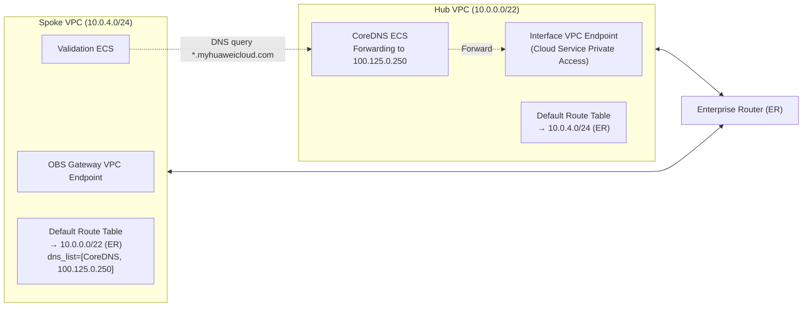

# Cross-VPC Sharing of Private Cloud Service Access (Huawei Cloud)

[](LICENSE)
[](https://www.huaweicloud.com)
[](https://www.terraform.io)

## 1. Introduction / Overview

This practice uses a **Hub-Spoke** topology to centrally host the private access endpoints for cloud services in the Hub VPC, and lets multiple Spoke VPCs transparently reuse these endpoints through an **Enterprise Router (ER)**. A lightweight **CoreDNS** forwarder is deployed in the Hub to resolve cloud service private domain names, enabling Spoke VPCs to reach the Hub's **Interface VPC Endpoints** — **without each VPC having to build its own Interface VPC Endpoints**. The core value lies in centrally hosting and reusing cloud service private access across VPCs.

## 2. Table of Contents

- [Architecture](#architecture)
- [Highlights](#highlights)
- [Huawei Cloud Services Used](#huawei-cloud-services-used)
- [Prerequisites](#prerequisites)
- [Quick Start](#quick-start)
- [Step-by-Step Deployment](#step-by-step-deployment)
- [Usage / Verification](#usage--verification)
- [Cleaning Up Resources](#cleaning-up-resources)
- [Detailed Explanation](#detailed-explanation)
- [Dependencies](#dependencies)
- [FAQ / Troubleshooting](#faq--troubleshooting)
- [Contributing](#contributing)
- [License](#license)
- [Contact / Maintainer](#contact--maintainer)

## 3. Architecture



The Hub centrally hosts Interface VPC Endpoints and a CoreDNS forwarder. The Spoke subnet's primary DNS points to CoreDNS, which forwards cloud service domain queries to the Hub's built-in DNS (100.125.0.250) and resolves them to the private IPs of the Interface VPC Endpoints. Traffic then flows along the path: Spoke → ER → Hub Endpoint → Cloud Service.

## 4. Highlights

- **Centrally hosted endpoints** — Interface VPC Endpoints are built once in the Hub and reused by every Spoke, without each VPC building its own.
- **Enterprise Router interconnection** — The Enterprise Router (ER) provides same-region Hub-Spoke network interconnection.
- **CoreDNS shared resolution** — A lightweight ECS forwarder in the Hub forwards cloud service private domain queries to the Hub's built-in DNS (100.125.0.250) and resolves them to Interface VPC Endpoint private IPs.
- **Native alternative** — In regions where it is available, Huawei Cloud's `dns_resolver_rule` conditional forwarding can replace CoreDNS directly (no ECS, no outbound internet required; availability must be confirmed in the console first).
- **Cross-account extensibility** — The single-account demo uses one provider; organization-wide sharing can be achieved via a provider alias + RAM-shared ER.

## 5. Huawei Cloud Services Used

| Huawei Cloud Service | Role |
|---|---|
| VPC / Subnet / Security Group | Hub and Spoke network isolation |
| VPC Endpoint (VPCEP) | Interface VPC Endpoint (Hub) + OBS Gateway VPC Endpoint (Spoke) |
| Enterprise Router (ER) | Same-region Hub-Spoke interconnection |
| Elastic Cloud Server (ECS) | CoreDNS forwarder + validation instance |
| RAM (optional) | Cross-account ER sharing |

After debugging, run `terraform destroy` to release resources (see [Cleaning Up Resources](#cleaning-up-resources)).

## 6. Prerequisites

| Item | Requirement |
|------|-------------|
| Account permissions | Permission to create VPC / VPCEP / ER / ECS / RAM; RAM sharing requires the primary account or delegated authorization |
| Tools | Terraform ≥ 1.9.0; network egress that can reach Huawei Cloud APIs |
| Region | Deployed within a single region (ER / VPCEP support same-region only) |
| Credentials | Obtain your Access Key and Secret Access Key from the Huawei Cloud “My Credentials” page, then set `HW_ACCESS_KEY` / `HW_SECRET_KEY` before deployment; do not write credentials into code or configuration files |
| Key Pair | Pre-create an ECS login key pair in the target region; pass it at deploy time via `-var="key_pair=<name>"` |
| Endpoint service ID | Query the published cloud service endpoint service ID in the target region's console (VPC → Endpoint Services → Public Endpoint Services) and fill it into `interface_endpoint_service_ids`; leaving it empty builds only the CoreDNS skeleton and ER interconnection. The OBS Gateway VPC Endpoint is optional (`enable_obs_gateway`, off by default — some regions have no standard OBS gateway service) |

## 7. Quick Start

```bash
# 1. Set credentials (replace placeholders; do not commit real values)
export HW_ACCESS_KEY="<HW_ACCESS_KEY>"
export HW_SECRET_KEY="<HW_SECRET_KEY>"
export HW_REGION_NAME="cn-north-4"

cd infra

# 2. Initialize (first run generates .terraform.lock.hcl)
terraform init

# 3. Preview (creates no resources)
terraform plan \
-var="region=cn-north-4" \
-var="key_pair=<your-key-pair-name>" \
-var='interface_endpoint_service_ids=["<service-id-1>","<service-id-2>"]'

# 4. Create
terraform apply \
-var="region=cn-north-4" \
-var="key_pair=<your-key-pair-name>" \
-var='interface_endpoint_service_ids=["<service-id-1>","<service-id-2>"]'
```

## 8. Step-by-Step Deployment

1. **Plan** — Confirm that Hub/Spoke VPCs, the ER instance + two VPC attachments, the CoreDNS ECS, and two ER private routes will be created. If `interface_endpoint_service_ids` is left empty, the Interface VPC Endpoint resource count = 0; the OBS Gateway VPC Endpoint is created only when `enable_obs_gateway=true`.
2. **Apply** — VPC/subnet/ER are created first, then the endpoints and ECS, and finally the routes (dependency order handled by Terraform). The Spoke subnet's `dns_list` is written once the CoreDNS ECS private IP is ready.
3. **Verify** — see [Usage / Verification](#usage--verification).

## 9. Usage / Verification

> **Two prerequisites (without either, this section's verification will not produce the expected result)**:
> ① `interface_endpoint_service_ids` has been filled with the target region's public endpoint service IDs and `apply` has been executed (otherwise there is no Interface VPC Endpoint in the Hub to resolve to);
> ② The CoreDNS forwarder has been installed successfully (first boot requires outbound internet, see Chapter 13 FAQ).

1. Log in to the Spoke validation ECS (via the Hub bastion host, key pair login).
2. Resolve a cloud service private domain — it should return the Hub endpoint's private IP (within `10.0.0.0/22`):
```bash
dig +short <cloud-service-private-domain>
```
3. (Optional) Access OBS through the Gateway VPC Endpoint (when `enable_obs_gateway=true`) — traffic should go through the OBS route injected into the Spoke route table, not the public network:
```bash
ping -c 3 obs.<region>.myhuaweicloud.com
curl -I https://obs.<region>.myhuaweicloud.com
```
4. From the Spoke ECS, access any Hub-hosted Interface VPC Endpoint service to confirm ER interconnection (Hub↔Spoke routes are both based on the Enterprise Router, type `er`).

> **Verify on your own after deployment**: please run the steps above on your own account to confirm the business functionality is actually working before treating the deployment as complete.

## 10. Cleanup (Cleaning Up Resources)

```bash
terraform destroy \
-var="region=cn-north-4" \
-var="key_pair=<your-key-pair-name>" \
-var='interface_endpoint_service_ids=["<service-id-1>","<service-id-2>"]'
```

> Release resources promptly after deletion to avoid leftovers. After destruction, confirm in the console / via API that no orphaned resources remain (especially the EVS disks that may be left behind after an ECS is deleted).

## 11. Detailed Explanation

- **Endpoint DNS sharing** — The Hub runs a CoreDNS forwarder; Huawei Cloud also offers native conditional forwarding (`dns_resolver_rule`), which can serve as a lighter alternative in available regions.
- **Default route table appending** — Each Huawei Cloud VPC has exactly one default route table (quota = 1); all routes are appended to it via `huaweicloud_vpc_route`, no new route table is created.
- **Security group egress** — Huawei Cloud security groups include an allow-all egress rule by default, so only ingress rules are declared.
- **Gateway vs Interface endpoint** — OBS uses a Gateway VPC Endpoint (no `network_id`, route auto-injected); an Interface VPC Endpoint requires a `network_id` (subnet ID).
- **Native alternative** — `huaweicloud_dns_resolver_rule` + `huaweicloud_dns_resolver_rule_associate` can replace CoreDNS via conditional forwarding (no ECS, no outbound internet). Regional availability varies — confirm in the console first.
- **Cross-account (production)** — The single-account demo uses one provider for both VPCs and the ER; for organization-wide sharing, use a provider alias + `huaweicloud_ram_resource_share` to share the ER (the receiver uses `huaweicloud_ram_resource_share_accepter`).

Full details are in [`docs/architecture.md`](docs/architecture.md) and [`docs/deployment-guide.md`](docs/deployment-guide.md).

## 12. Dependencies

- **Terraform** + [`huaweicloud` provider](https://registry.terraform.io/providers/huaweicloud/huaweicloud/latest) (≥ 1.96.1)
- **CoreDNS** (Apache 2.0) — DNS forwarder running on the Hub ECS (`src/coredns/user-data.yaml`)

## 13. FAQ / Troubleshooting

- **`dig` returns a public IP instead of the Hub endpoint's private IP?** Check the Spoke subnet's `dns_list` — the CoreDNS IP must be listed first; confirm the CoreDNS ECS is running and the security group allows port 53 access from `10.0.0.0/21`.
- **CoreDNS ECS cannot be installed (no outbound internet)?** `enable_nat_gateway=false` by default. Set `enable_nat_gateway=true` for outbound internet on first boot, or bake CoreDNS into a custom image.
- **OBS access still goes over the public network?** Confirm the OBS Gateway VPC Endpoint's `routetables` already includes the Spoke default route table; the OBS route is auto-injected into it.
- **Interface VPC Endpoints always empty?** You must obtain `interface_endpoint_service_ids` from the target region's console and fill them in; leaving them empty builds only the OBS Gateway VPC Endpoint + CoreDNS skeleton.

## 14. Contributing

Issues and pull requests are welcome. For structural changes, please open a discussion first.

## 15. License

This practice is licensed under [MIT No Attribution](LICENSE).

## 17. Contact / Maintainer

| **Creator** | <github-username> |
|---|---|
| **Maintainer** | <github-username> |

Contact: Issues are welcome in this repository for questions or suggestions.
