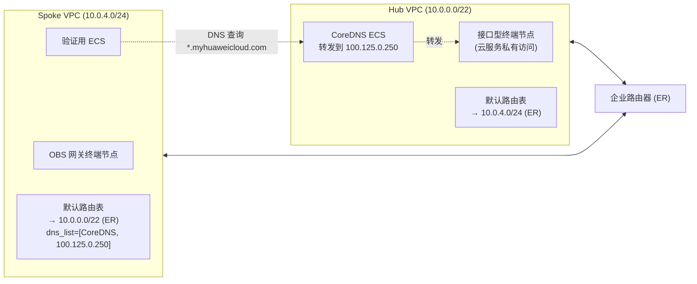

# 跨 VPC 共享云服务私有访问（华为云）

[](LICENSE)
[](https://www.huaweicloud.com)
[](https://www.terraform.io)

## 1. 简介

采用 **中心辐射（Hub-Spoke）** 拓扑，将云服务的私有访问终端节点集中托管在 Hub VPC，并通过企业路由器（ER）让多个 Spoke VPC 透明复用这些终端节点。Hub 内部署一台轻量 CoreDNS 转发器，负责解析云服务私有域名，使 Spoke 能够访问 Hub 的接口型终端节点——**无需每个 VPC 各自建设接口型终端节点**。核心价值在于将云服务私有访问能力集中托管、跨 VPC 复用。

## 2. 目录

- [架构图](#架构图)
- [方案亮点](#方案亮点)
- [涉及云服务](#涉及云服务)
- [前置条件](#前置条件)
- [快速开始](#快速开始)
- [分步部署](#分步部署)
- [使用方法/验证](#使用方法验证)
- [清理资源](#清理资源)
- [详细说明](#详细说明)
- [依赖](#依赖)
- [FAQ/常见问题](#faq常见问题)
- [贡献指南](#贡献指南)
- [许可证](#许可证)
- [联系方式/维护者](#联系方式维护者)

## 3. 架构图



Hub 集中托管接口型终端节点与一台 CoreDNS 转发器。Spoke 子网的 DNS 首选指向 CoreDNS，CoreDNS 将云服务域名查询转发至 Hub 内置 DNS（100.125.0.250），并解析为接口型终端节点的私网 IP。随后流量沿 Spoke → ER → Hub 终端节点 → 云服务 的路径流动。

## 4. 方案亮点

- **集中托管终端节点** — 在 Hub 内统一建设接口型终端节点，各 Spoke 直接复用，无需每个 VPC 单独建设。
- **企业路由器互联** — 企业路由器（ER）提供同区域 Hub-Spoke 网络互通。
- **CoreDNS 共享解析** — Hub 内部署轻量 ECS 转发器，将云服务私有域名查询转发至 Hub 内置 DNS（100.125.0.250），解析到接口型终端节点私网 IP。
- **原生替代方案** — 在已上线区域，可用华为云 `dns_resolver_rule` 条件转发直接替换 CoreDNS（免 ECS、免出网，需先在控制台确认 region 可用性）。
- **跨账号可扩展** — 单账号演示使用同一 provider；组织级共享可通过 provider alias + RAM 共享 ER 实现。

## 5. 涉及云服务

| 华为云服务 | 角色 |
|---|---|
| VPC / 子网 / 安全组 | Hub 与 Spoke 网络隔离 |
| VPC 终端节点（VPCEP） | 接口型终端节点（Hub）+ OBS 网关终端节点（Spoke） |
| 企业路由器（ER） | 同区域 Hub-Spoke 互联 |
| 弹性云服务器（ECS） | CoreDNS 转发器 + 验证实例 |
| RAM（可选） | 跨账号 ER 共享 |

调试完成后，执行 `terraform destroy` 释放资源（详见[清理资源](#清理资源)）。

## 6. 前置条件

| 项目 | 要求 |
|------|-------------|
| 账号权限 | 具备 VPC / VPCEP / ER / ECS / RAM 的创建权限；RAM 共享需主账号或被授权 |
| 工具 | Terraform ≥ 1.9.0；可访问华为云 API 的网络出口 |
| 区域 | 单 region 内部署（ER / VPCEP 仅支持同区域） |
| 密钥 | 请在华为云“我的凭证”页面获取 Access Key 与 Secret Access Key，并在部署前设置为 `HW_ACCESS_KEY` / `HW_SECRET_KEY`；不要将凭据写入代码或配置文件 |
| 密钥对 | 在目标 region 预先创建 ECS 登录密钥对，部署时通过 `-var="key_pair=<名称>"` 传入 |
| 终端节点服务 ID | 在目标 region 控制台查询已发布的云服务型终端节点 ID（VPC → 终端节点服务 → 公共终端节点服务），填入 `interface_endpoint_service_ids`；留空则仅建设 CoreDNS 骨架与 ER 互联。OBS 网关终端节点为可选（`enable_obs_gateway`，默认关闭——部分 region 无标准 OBS 网关服务） |

## 7. 快速开始

```bash
# 1. 设置访问密钥（替换占位符；不要提交真实值）
export HW_ACCESS_KEY="<HW_ACCESS_KEY>"
export HW_SECRET_KEY="<HW_SECRET_KEY>"
export HW_REGION_NAME="cn-north-4"

cd infra

# 2. 初始化（首次运行会生成 .terraform.lock.hcl）
terraform init

# 3. 预览（不创建任何资源）
terraform plan \
-var="region=cn-north-4" \
-var="key_pair=<your-key-pair-name>" \
-var='interface_endpoint_service_ids=["<service-id-1>","<service-id-2>"]'

# 4. 创建
terraform apply \
-var="region=cn-north-4" \
-var="key_pair=<your-key-pair-name>" \
-var='interface_endpoint_service_ids=["<service-id-1>","<service-id-2>"]'
```

## 8. 分步部署

1. **Plan** — 确认将创建 Hub/Spoke VPC、ER 实例 + 两个 VPC 连接、CoreDNS ECS 以及两条 ER 私网路由。若 `interface_endpoint_service_ids` 留空，接口型终端节点资源数 = 0；OBS 网关终端节点仅在 `enable_obs_gateway=true` 时创建。
2. **Apply** — VPC/子网/ER 先建，随后是终端节点与 ECS，最后是路由（依赖顺序由 Terraform 处理）。Spoke 子网的 `dns_list` 在 CoreDNS ECS 私网 IP 就绪后写入。
3. **验证** — 见[使用方法/验证](#使用方法验证)。

## 9. 使用方法/验证

> **两项前置条件（缺一则本节验证得不到预期结果）**：
> ① `interface_endpoint_service_ids` 已填入目标 region 的公共终端节点服务 ID 并执行 `apply`（否则 Hub 侧没有接口型终端节点可被解析）；
> ② CoreDNS 转发器已安装成功（首次引导需出网，见第 13 章 FAQ）。

1. 登录 Spoke 验证用 ECS（经由 Hub 跳板机，密钥对登录）。
2. 解析某个云服务私有域名——应返回 Hub 终端节点的私网 IP（位于 `10.0.0.0/22` 内）：
```bash
dig +short <cloud-service-private-domain>
```
3. （可选）通过网关终端节点访问 OBS（当 `enable_obs_gateway=true` 时）——流量应走注入 Spoke 路由表的 OBS 路由，而非公网：
```bash
ping -c 3 obs.<region>.myhuaweicloud.com
curl -I https://obs.<region>.myhuaweicloud.com
```
4. 从 Spoke ECS 访问任意 Hub 托管的接口型终端节点服务，确认 ER 互通（Hub↔Spoke 路由均基于企业路由器、类型为 er）。

> **部署后请自行验证**：请在你自己的账号上按上述步骤实际操作，确认业务功能确实可用，再将部署视为完成。

## 10. 清理资源

```bash
terraform destroy \
-var="region=cn-north-4" \
-var="key_pair=<your-key-pair-name>" \
-var='interface_endpoint_service_ids=["<service-id-1>","<service-id-2>"]'
```

> 删除资源后及时释放，避免残留。销毁后请在控制台 / 通过 API 确认无孤儿资源遗留（尤其是 ECS 删除后可能残留的 EVS 云硬盘）。

## 11. 详细说明

- **终端节点 DNS 共享** — Hub 运行 CoreDNS 转发器；华为云同时提供原生条件转发（`dns_resolver_rule`），在可用区域可作为更轻量的替代方案。
- **默认路由表追加** — 每个华为云 VPC 仅有且仅有一个默认路由表（配额 = 1）；所有路由均通过 `huaweicloud_vpc_route` 追加到该表，不新建路由表。
- **安全组出方向** — 华为云安全组默认包含 allow-all 出方向，因此仅声明入方向规则。
- **网关型 vs 接口型终端节点** — OBS 使用网关型终端节点（无 `network_id`，自动注入路由）；接口型终端节点需要 `network_id`（子网 ID）。
- **原生替代方案** — `huaweicloud_dns_resolver_rule` + `huaweicloud_dns_resolver_rule_associate` 可通过条件转发替换 CoreDNS（免 ECS、免出网）。区域可用性有差异——请先在控制台确认。
- **跨账号（生产）** — 单账号演示对两个 VPC 与 ER 使用同一 provider；若要做组织级共享，使用 provider alias + `huaweicloud_ram_resource_share` 共享 ER（接收方使用 `huaweicloud_ram_resource_share_accepter`）。

完整说明见 [`docs/architecture.md`](docs/architecture.md) 与 [`docs/deployment-guide.md`](docs/deployment-guide.md)。

## 12. 依赖

- **Terraform** + [`huaweicloud` provider](https://registry.terraform.io/providers/huaweicloud/huaweicloud/latest)（≥ 1.96.1）
- **CoreDNS**（Apache 2.0）— 运行于 Hub ECS 的 DNS 转发器（`src/coredns/user-data.yaml`）

## 13. FAQ/常见问题

- **`dig` 返回的是公网 IP，而非 Hub 终端节点私网 IP？** 检查 Spoke 子网的 `dns_list`——CoreDNS IP 必须排在第一位；确认 CoreDNS ECS 正在运行且安全组允许来自 `10.0.0.0/21` 的 53 端口访问。
- **CoreDNS ECS 无法安装（无出网）？** 默认 `enable_nat_gateway=false`。可设置 `enable_nat_gateway=true` 以在首次启动时出网，或将 CoreDNS 固化到自定义镜像中。
- **OBS 访问仍走公网？** 确认 OBS 网关终端节点的 `routetables` 已包含 Spoke 默认路由表；OBS 路由会自动注入该表。
- **接口型终端节点始终为空？** 必须从目标 region 控制台获取 `interface_endpoint_service_ids` 后填入；留空则仅建设 OBS 网关终端节点 + CoreDNS 骨架。

## 14. 贡献指南

欢迎提交 issue 与 pull request。涉及结构性变更，请先开 discussion 讨论。

## 15. 许可证

本实践采用 [MIT No Attribution](LICENSE) 许可证。

## 16. 联系方式/维护者

| **创建者** | dgc-git |
|---|---|
| **维护者** | dgc-git |

交流渠道：欢迎在本仓库提交 issue 反馈问题或建议。
