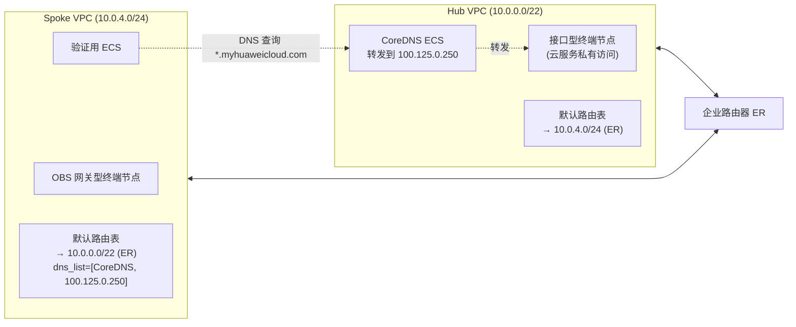

# 跨 VPC 共享云服务私有访问 · 架构说明

> 在华为云上，用「中心辐射（Hub-Spoke）」拓扑把云服务的私有访问能力集中托管在 Hub VPC
> 通过企业路由器（ER）互联多个 Spoke VPC，并借助 Hub 内的 DNS 转发器让 Spoke 透明复用 Hub 的
> 终端节点。核心价值：**一处托管、多 VPC 复用，无需每个 VPC 各自建设接口型终端节点**。

## 架构图

## 组件与职责

| 组件 | 华为云资源 | 职责 |
|------|-----------|------|
| Hub VPC | `huaweicloud_vpc` + 3 子网 | 集中托管接口型终端节点与 DNS 转发器 |
| Hub 接口终端节点 | `huaweicloud_vpcep_endpoint`（接口型，`enable_dns`） | 提供云服务的私有访问入口 |
| CoreDNS 转发器 | `huaweicloud_compute_instance` + user-data | 把云服务域名查询转发到 Hub 内置 DNS，解析出终端节点私有 IP |
| Spoke VPC | `huaweicloud_vpc` + 3 子网 | 工作负载 VPC，`dns_list` 首位指向 CoreDNS |
| OBS 网关终端节点 | `huaweicloud_vpcep_endpoint`（网关型） | Spoke 内私有访问 OBS，自动注入路由 |
| 企业路由器 ER | `huaweicloud_er_instance` + `huaweicloud_er_vpc_attachment` | 同区域互联 Hub / Spoke VPC |
| 私网路由 | `huaweicloud_vpc_route`（`type=er`） | Hub↔Spoke 互指，下一跳为 ER |
| RAM 共享（可选） | `huaweicloud_ram_resource_share` | 跨账号共享 ER |

## 流量路径（以 Spoke 访问云服务为例）

1. Spoke 内 ECS 解析 `*.myhuaweicloud.com`，由于子网 `dns_list` 首位为 CoreDNS，查询发往 Hub 的 CoreDNS。
2. CoreDNS（位于 Hub VPC）把查询转发到 Hub 内置 DNS `100.125.0.250`，后者把接口终端节点的私有域名解析为终端节点私有 IP。
3. 响应沿原路返回 Spoke ECS。
4. 后续业务流量：Spoke → ER（依据 `spoke_to_hub` 路由）→ Hub 终端节点私有 IP → 云服务。
5. OBS 访问走 Spoke 的网关型终端节点（`obs_gateway`），由关联路由表自动注入的 OBS 路由承接。

## 关键设计点

- **终端节点 DNS 共享**：Hub 内自建 CoreDNS 转发器，把云服务私有域名查询转发到 Hub 内置 DNS；若目标 region 已上线原生条件转发（`dns_resolver_rule`），可免 ECS 实现同样效果。
- **默认路由表追路由**：华为云每 VPC 仅 1 张默认路由表（配额=1），所有路由均追加到默认表，不新建表。
- **安全组出方向**：华为云安全组默认自带 allow-all egress，故仅声明入方向规则，不重复建全放出方向。
- **网关型终端节点**：OBS 走网关型，无需 `network_id`，自动注入路由；接口型才需要 `network_id`（子网 ID）。
- **原生条件转发（推荐评估）**：华为云提供 `huaweicloud_dns_resolver_rule` + `huaweicloud_dns_resolver_rule_associate`（条件转发规则 + 关联 VPC），可直接将指定域名转发到目标 IP 并关联 Spoke VPC——无需 ECS、无需出网安装。生产若追求最简运维，可优先评估该原生能力（按 region 可用性确认）。

## 区域与配额

- 本方案为**同区域**架构（Hub / Spoke 在同一 region），ER 与 VPCEP 均仅支持同区域。
- 跨区域场景需在每个 region 重复部署终端节点与转发器。
